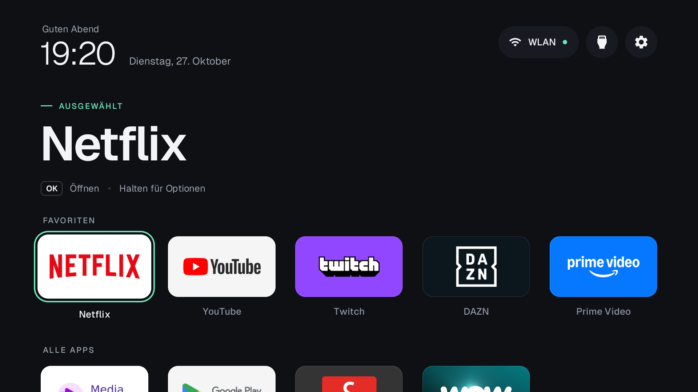
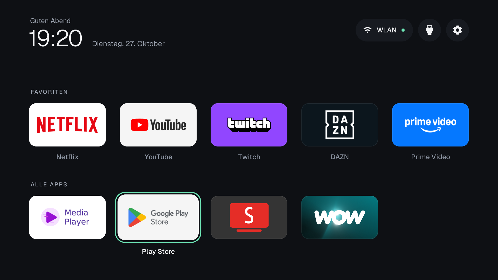
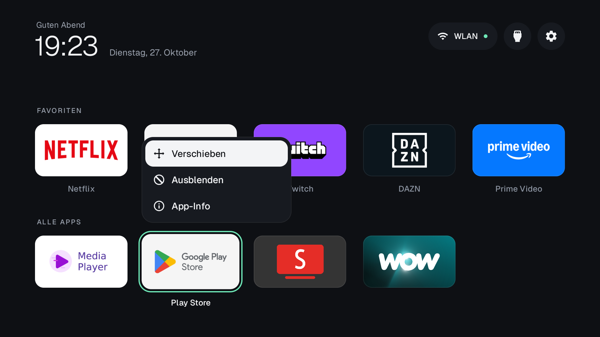
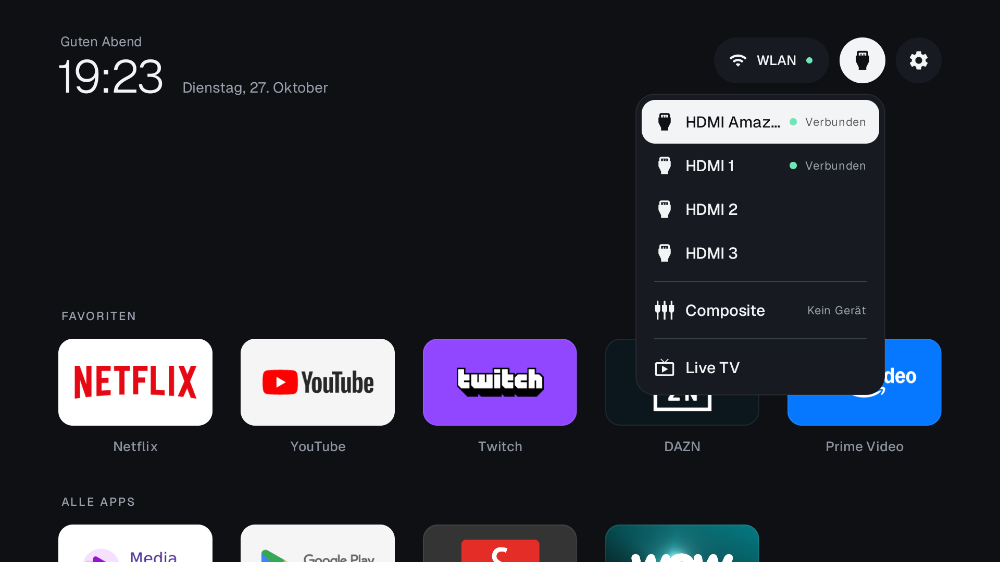
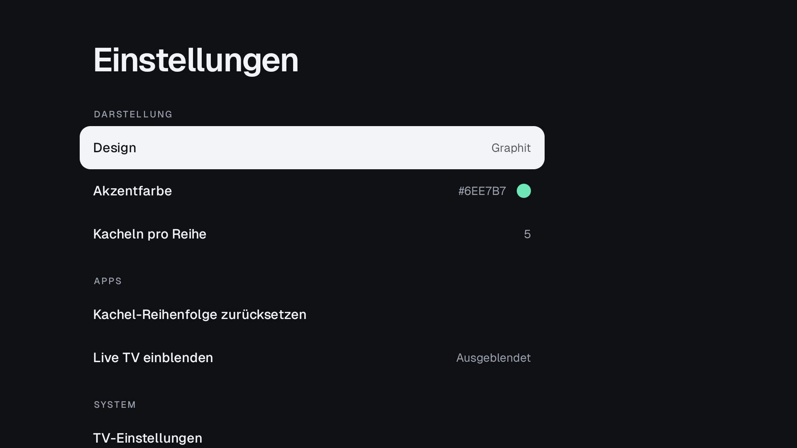
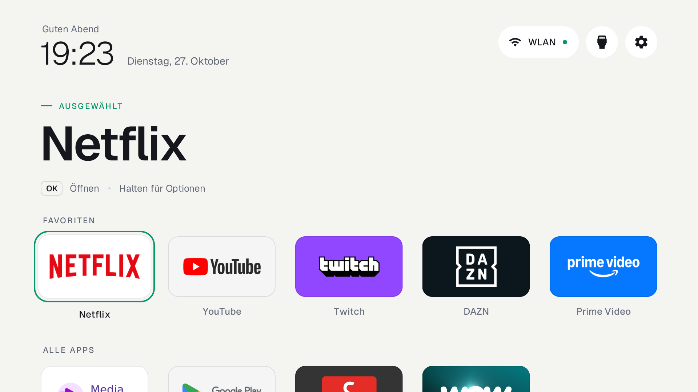

# quietv

**A calm home screen for your TV. No ads, no rows of things you never asked for.**

quietv strips the ads, telemetry and preloaded clutter from Android TV, Google TV and Fire TV over ADB,
and replaces the stock home screen with a small, fast launcher: your apps, your order, nothing else.

- **One APK for every TV.** Download it from Releases, no Android SDK needed. Settings live on the TV.
- **Fire TV and Google TV too.** Where the stock home cannot be replaced safely, quietv keeps it and opens
  itself instead.
- **Reversible.** Packages are disabled, never uninstalled. Every debloat starts with a backup.
- **Light.** Built for sets with 1 GB of RAM. No tracking, no background work, no network traffic
  unless you switch on the optional companion feature.
- **One CLI for Windows, macOS and Linux**, or let an AI coding agent do the setup for you.



| All apps | Hold OK on a tile | Inputs |
|---|---|---|
|  |  |  |

| Settings | Paper theme |
|---|---|
|  |  |

Screenshots from a CHiQ AI PONT (Android TV 11), taken with `quietv screenshot`.

## Quick start

You need the TV's IP address and ADB debugging switched on:
Settings → Device Preferences → About → press OK on **Build** seven times, then
Developer options → **USB debugging** (and **Network debugging** if your TV has it).
On Fire TV: Settings → My Fire TV → Developer options → **ADB debugging**.

### With the CLI

```bash
uv tool install "git+https://github.com/nowaaak/quietv#subdirectory=cli"   # or: pipx install ...
export QUIETV_HOST=192.168.1.50                                           # PowerShell: $env:QUIETV_HOST="..."

quietv probe                                  # model, Android version, current home
quietv backup                                 # packages, settings, home app, keyboard
quietv debloat chiq-ai-pont --dry-run         # a list from devices/, by name or path
quietv debloat chiq-ai-pont                   # disables, after an automatic backup
quietv install                                # latest release, checksum verified
```

Accept the "Allow USB debugging?" prompt on the TV the first time. `quietv restore` undoes the debloat
from the newest backup. `quietv --help` lists everything.

Some newer TVs only offer **Wireless debugging** with a pairing code. Open it, choose "Pair device with
pairing code" and run `quietv pair <pairing port> <code> <port>` once. This needs Android's `adb` tool,
everything after it does not.

After a firmware update, `quietv check` finds packages the update switched back on and
`quietv check --fix` disables them again. quietv never disables packages a TV needs to work, such as
TV settings, the keyboard in use or the services behind the HDMI inputs, even if a device list says so.

### With an AI coding agent

Clone this repo and ask Claude Code, Codex, Gemini CLI or a similar agent to set up your TV.
[AGENTS.md](AGENTS.md) tells it how: back up first, sort the packages into categories, ask before
touching apps you might use, verify every step with a screenshot from the TV.

### Just the launcher

Download `quietv.apk` from [Releases](https://github.com/nowaaak/quietv/releases), check it against
`SHA256SUMS` and install it with any ADB tool. On Fire TV, follow [docs/fire-tv.md](docs/fire-tv.md).
No computer? See [docs/phone-install.md](docs/phone-install.md).

## The launcher

- Your favourites in a row at the bottom, the rest of your apps in a grid below. Press Down to see them.
- One focus ring that springs from tile to tile. The focused favourite's name stands above the row.
- Hold OK on a tile to move it, hide it or open its app info.
- Inputs menu with HDMI ports, AV and Live TV through the TV input framework.
- Six themes, your own colours, tile corners and an optional wallpaper that stays readable.
  [Themes](docs/themes.md).
- Settings on the TV: theme, accent colour, tile corners, tiles per row, wallpaper, hidden apps.
- Clock, date and greeting in [Geist](https://vercel.com/font). English and German.

Everything is configurable on the TV. To set up many TVs the same way, keep a JSON file and push it:

```bash
quietv config pull my-tv.json
quietv config push my-tv.json
```

See [docs/configuration.md](docs/configuration.md) for every option.

## Device lists

[`devices/`](devices/) holds one TOML file per tested TV. Each package has a category (ads,
telemetry, cast, assistant, ...) and a tier:

| Tier | Meaning |
|---|---|
| `recommended` | Ads, telemetry and clutter. Safe for everyone. |
| `advanced` | Features some people use: casting, voice, vendor updates, preloaded streaming apps. |
| `expert` | Can break something. Read the note first. |

`quietv debloat` applies `recommended` by default. Use `--tier advanced` to go further and
`--exclude cast` to skip a category.

| TV | OS | File |
|---|---|---|
| CHiQ AI PONT | Android TV 11 | [chiq-ai-pont.toml](devices/chiq-ai-pont.toml) |
| Xiaomi Mi TV 4A | Android TV 10 | [xiaomi-mi-tv-4a.toml](devices/xiaomi-mi-tv-4a.toml) |
| Fire TV Stick 4K Max (2nd gen) | Fire OS 8 | [amazon-fire-tv-stick-4k-max-2.toml](devices/amazon-fire-tv-stick-4k-max-2.toml) |
| Toshiba Fire TV (AFTHA004) | Fire OS 7 | [toshiba-fire-tv-aftha004.toml](devices/toshiba-fire-tv-aftha004.toml) |

Your TV is missing? [Add it](CONTRIBUTING.md#add-your-tv). It is the most useful contribution there is.
`quietv report` writes everything the device report needs into one file.

## Supported TVs

Android TV and Google TV from any brand (Sony, TCL, Hisense, Xiaomi, Philips, CHiQ, Nvidia Shield and
others) and Amazon Fire TV. Not Samsung Tizen or LG webOS. Android 8.0 or newer.

## Documentation

- [Configuration](docs/configuration.md)
- [Themes](docs/themes.md)
- [Fire TV](docs/fire-tv.md)
- [Google TV](docs/google-tv.md)
- [Troubleshooting](docs/troubleshooting.md)
- [Install from a phone](docs/phone-install.md)
- [Roadmap](ROADMAP.md)

## Contributing

Device lists, launcher features, translations and fixes are welcome. Read
[CONTRIBUTING.md](CONTRIBUTING.md) first.

## Credits and licence

quietv started as a fork of [cleanyourtv](https://github.com/Gathin23/cleanyourtv) by Gathin, with Fire TV
support by Umang Chauhan. See [NOTICE.md](NOTICE.md).

MIT, see [LICENSE](LICENSE). The Geist typeface is under the SIL Open Font License, see
[launcher/FONT-LICENSE-OFL.txt](launcher/FONT-LICENSE-OFL.txt).
